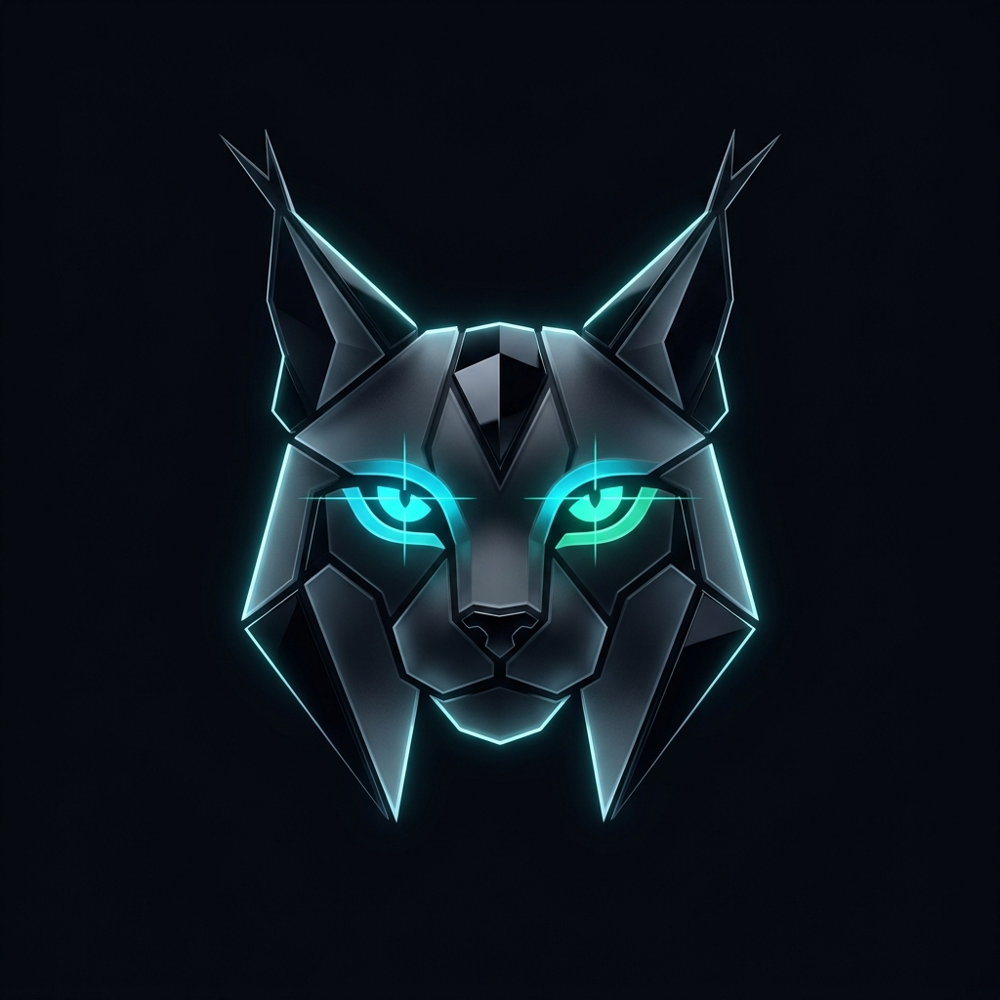
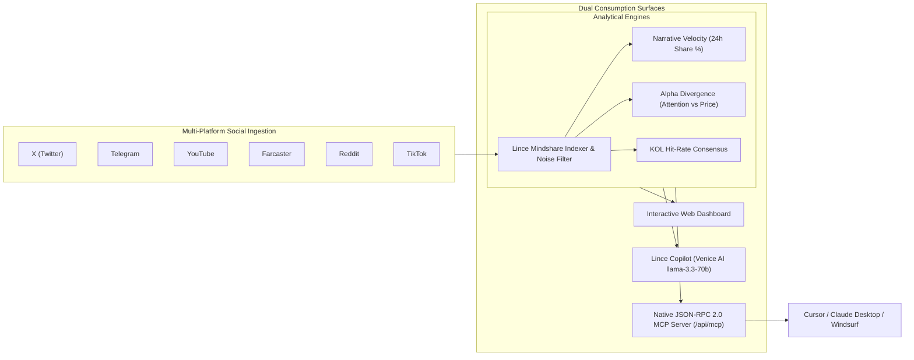

<p align="center">
  
</p>

<h1 align="center">Lince</h1>

<p align="center">
  <strong>Crypto Mindshare, Narrative Velocity &amp; KOL Intelligence Terminal</strong><br>
  <em>Vista de Lince — Powered by Venice AI Zero-Logging Private Inference &amp; Native Model Context Protocol (MCP)</em>
</p>

<p align="center">
  <a href="https://lince-alpha.vercel.app"></a>
</p>

<p align="center">
  <a href="https://modelcontextprotocol.io"></a>
  <a href="https://venice.ai"></a>
  <a href="https://nextjs.org"></a>
  <a href="https://www.typescriptlang.org"></a>
  <a href="https://tailwindcss.com"></a>
  <a href="https://opensource.org/licenses/MIT"></a>
</p>

---

## Overview

**Lince** is an institutional-grade, zero-logging crypto intelligence platform and **Model Context Protocol (MCP)** server inspired by modern narrative terminals like Dexu and Kaito.

In Spanish folklore, the phrase **"Tener vista de lince"** describes someone with lynx-like vision—the rare ability to spot subtle patterns and opportunities that others miss. Lince continuously indexes social attention across **six channels** (X, Telegram, YouTube, Farcaster, Reddit, and TikTok) alongside on-chain DEX metrics, transforming chaotic market noise into quantifiable **Alpha Divergence signals**.

---

## Why Lince?

1. **Spotting Alpha Divergence Before Price Catches Up:**  
   In modern crypto cycles, price follows mindshare. Lince's proprietary algorithm flags tokens where developer activity, KOL focus, and community chatter surge (+40% to +85%) while market capitalization or token price remains stagnant—signaling early institutional or smart-money accumulation.
2. **Zero-Data-Retention Private Inference (Powered by Venice AI):**  
   Trading research requires confidentiality. Traditional AI platforms retain and train on user prompts, leaking your watchlist and trading alpha. Lince integrates **[Venice AI](https://venice.ai)** (`llama-3.3-70b` & `deepseek-r1`) via standard OpenAI-compatible endpoints with zero prompt logging and zero censorship.
3. **Native Model Context Protocol (MCP) Server (`/api/mcp`):**  
   Lince isn't just a browser dashboard—it is an **active MCP provider**. AI coding IDEs and autonomous agents (such as **Cursor**, **Claude Desktop**, and **Windsurf**) can query real-time crypto mindshare, KOL consensus, and divergence signals directly inside their development environments.
4. **Zero-Friction "Explore Before You Sign Up" Experience:**  
   No wallet connections, mandatory logins, or paywalls required to inspect live market metrics.

---

## System Architecture



---

## Repository Structure

```text
lince/
├── src/
│   ├── app/
│   │   ├── page.tsx                    # Master Terminal: Hero, Live Explorer, Copilot & Showcase
│   │   ├── layout.tsx                  # Root layout with Geist font & Precision Carbon theme
│   │   ├── globals.css                 # Tailwind CSS v4 styling & dark mode palette
│   │   └── api/
│   │       ├── copilot/
│   │       │   └── route.ts            # POST Copilot query: Venice AI streaming + Free Deterministic engine
│   │       └── mcp/
│   │           └── route.ts            # POST JSON-RPC 2.0 Model Context Protocol endpoint
│   ├── components/
│   │   ├── Header.tsx                  # Top navigation, live telemetry ticker, and modal triggers
│   │   ├── HeroSection.tsx             # Value proposition, global command search, and 4 metric cards
│   │   ├── LiveExplorer.tsx            # Dexu-style 4-tab interactive terminal (Narratives, Alpha, KOLs, Socials)
│   │   ├── CopilotTerminal.tsx         # Interactive AI chat with presets, sentiment gauge, and citation chips
│   │   ├── LynxLogo.tsx                # Crisp geometric Lynx Eye SVG vector component
│   │   ├── McpModal.tsx                # 1-click MCP configuration modal for Cursor and Claude Desktop
│   │   └── VeniceKeyModal.tsx          # Bring-Your-Own-Key (BYOK) modal for Venice AI configuration
│   └── lib/
│       ├── types.ts                    # TypeScript interfaces for Narratives, Divergences, KOLs, and MCP
│       └── data.ts                     # Real-time multi-platform data engine & seeded social metrics
├── public/
│   ├── logo.jpg                        # Official Lince brand emblem (Obsidian Glassmorphic Lynx)
│   └── logo.png                        # Web3 brand icon asset
├── next.config.ts                      # Next.js 16 Turbopack configuration
├── tsconfig.json                       # Strict TypeScript configuration
└── package.json                        # Dependencies (Next.js 16, React 19, Lucide, Tailwind v4)
```

---

## Technical & Engineering Highlights

### 1. Alpha Divergence Algorithm (`src/lib/data.ts`)
Lince calculates a composite **Divergence Score (0–100)** to pinpoint structural pricing inefficiencies:
$$\text{Divergence Score} = f\left(\Delta \text{Mindshare}_{24h}, \Delta \text{Price}_{24h}, \text{Smart Follower Ratio}, \text{Velocity Momentum}\right)$$

* When $\Delta \text{Mindshare}_{24h} \gg \Delta \text{Price}_{24h}$ alongside verified developer commits or testnet traction, the signal triggers an **`EARLY_ACCUMULATION`** or **`NARRATIVE_BREAKOUT`** classification.

### 2. Model Context Protocol (MCP) Implementation (`src/app/api/mcp/route.ts`)
Complies with the official **Model Context Protocol specification (2024-11-05)** over standard HTTP POST JSON-RPC 2.0:
* **`initialize`:** Reports protocol version, server metadata, and tools capability.
* **`tools/list`:** Returns JSON Schema definitions for:
  * `lince_get_narratives`: Ranks market sectors by mindshare percentage and 24h acceleration.
  * `lince_get_alpha_divergence`: Filters tokens by minimum divergence score threshold.
  * `lince_get_kols`: Queries analyst track records, verified hit-rates, and active calls.
  * `lince_get_social_platforms`: Platform breakdown of discussion volume across social channels.
* **`tools/call`:** Executes the requested analytical tool and returns formatted LLM context blocks.

### 3. Dual-Engine Intelligence Copilot (`src/app/api/copilot/route.ts`)
* **Venice AI Private Inference:** When an API key is present (`VENICE_API_KEY` or client BYOK), queries route directly to `https://api.venice.ai/api/v1/chat/completions` using `llama-3.3-70b` for private, zero-retention market synthesis.
* **Deterministic Fallback Engine:** For instant public evaluation (Rp 0 cost), the platform includes a zero-latency heuristic engine that parses market entities, extracts mentioned tickers, calculates sentiment polarity, and returns structured citation chips.

---

## MCP Setup Guide (Connect Your AI Tools)

### For Cursor (`~/.cursor/mcp.json`):
```json
{
  "mcpServers": {
    "lince": {
      "url": "https://lince-alpha.vercel.app/api/mcp",
      "transport": "http"
    }
  }
}
```

### For Claude Desktop (`claude_desktop_config.json`):
```json
{
  "mcpServers": {
    "lince": {
      "command": "npx",
      "args": ["-y", "mcp-proxy-http", "https://lince-alpha.vercel.app/api/mcp"]
    }
  }
}
```

---

## Quick Start (Local Development)

```bash
# 1. Clone the repository
git clone https://github.com/Blanksite/lince.git
cd lince

# 2. Install dependencies
npm install

# 3. Start local development server
npm run dev
```

Open [http://localhost:3000](http://localhost:3000) in your browser.

### Production Build Verification

```bash
npm run build
```

---

## User Safety & Privacy Disclosure

* **Non-Custodial & Read-Only:** Lince does not request or store private keys or seed phrases.
* **Client-Side BYOK Storage:** Custom Venice AI API keys configured via the modal are stored strictly in client-side memory (`sessionStorage` / React state) and sent directly to the Venice AI API proxy.
* **Zero Logging:** Lince does not store or sell user search queries.

---

## License

MIT License. Open-source crypto intelligence infrastructure.
